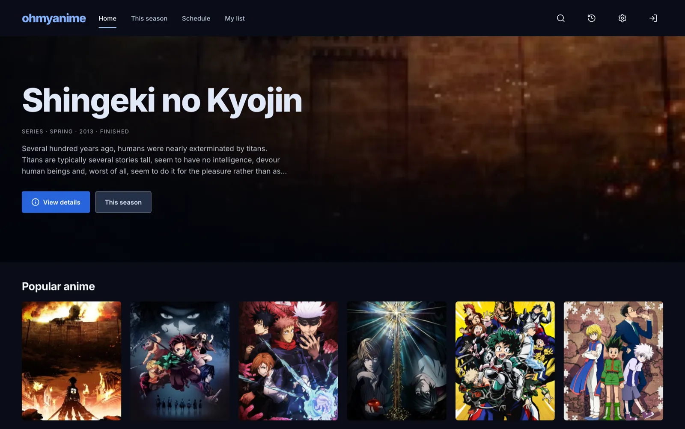
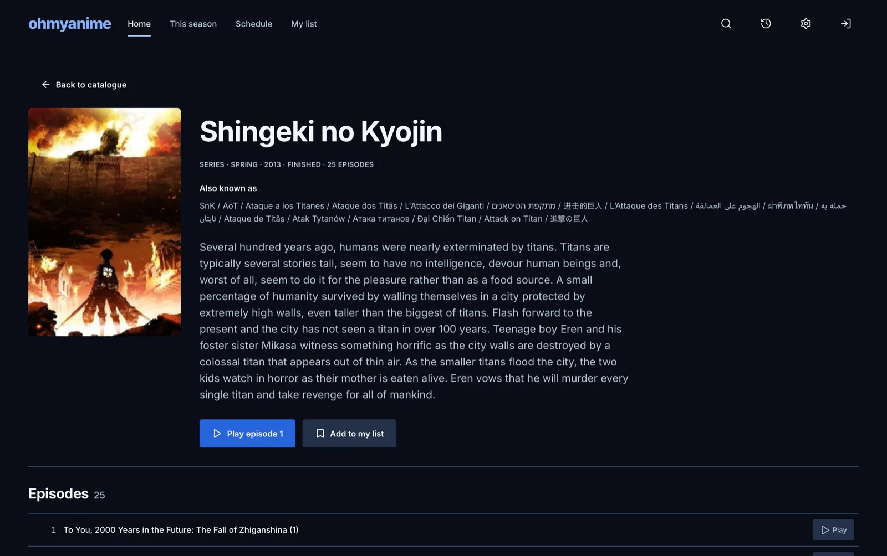
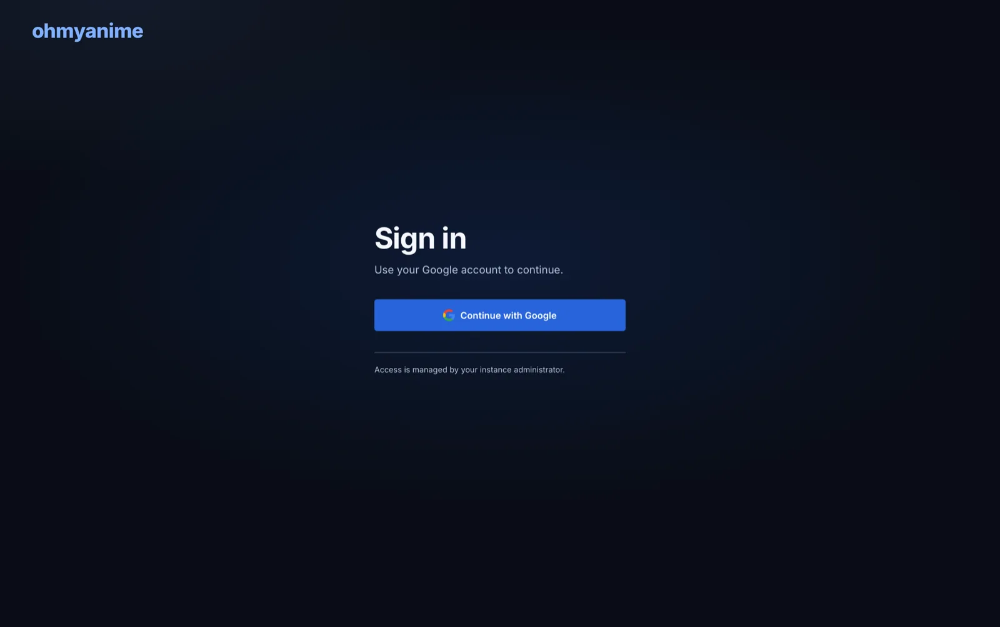

# OhMyAnime

A self-hosted anime streaming app: browse a catalogue, track what you watch, and
play episodes in an immersive player. Go backend, React frontend, and a native
desktop build that ships as a single binary.

Browsing is public. Watching needs a Google account, and the instance decides
which accounts it accepts.



## Features

- **Catalogue** — popular anime, seasonal browsing with genre and year filters,
  search, and a weekly release schedule in your local timezone.
- **Title pages** — real metadata, episode inventory with actual episode titles,
  and per-episode provider availability.
- **Player** — custom overlay on hls.js with quality, speed, audio and subtitle
  tracks, episode queue, skip intro/outro, and WebVTT import. Native HLS is used
  where the browser supports it.
- **Library** — saved list, watch history with resume, and progress that survives
  restarts.
- **Appearance** — Dark, Light, or System, following the OS while in System mode.
- **Desktop** — one binary, private loopback backend, native window.



## How it works

```
Browser / desktop webview
        │  REST + HLS
        ▼
Go server ── metadata + episodes ──► public catalogue API
   │
   ├── provider adapters ──► episode sources
   ├── media proxy (capability-scoped HLS)
   └── SQLite (library, history, settings)
```

The server never hands the browser an upstream URL. A playback session mints
capability-scoped local paths, and the proxy streams bytes with range support.

## Requirements

- Go **1.27.3+**
- [Bun](https://bun.sh) for the frontend
- A Google OAuth client (see below)
- Desktop: macOS WKWebView, Windows WebView2, or Linux GTK3/WebKitGTK with media
  codecs

## Setup

### 1. Google sign-in

Create an OAuth **Web application** client in Google Cloud Console and register
the callback URI:

```
http://localhost:5173/api/v1/auth/google/callback     # development
https://your-host/api/v1/auth/google/callback         # deployment
```

For the desktop app, create a second OAuth **Desktop app** client. Google only
allows loopback redirects on installed-app clients, so the two never mix.

### 2. Configure

```sh
cp .env.example .env
```

```sh
MYANIME_GOOGLE_CLIENT_ID=…apps.googleusercontent.com
MYANIME_GOOGLE_CLIENT_SECRET=…
MYANIME_GOOGLE_ALLOWED_EMAILS=you@example.com
# or allow a whole domain:
# MYANIME_GOOGLE_ALLOWED_DOMAINS=example.com

# desktop only
MYANIME_GOOGLE_DESKTOP_CLIENT_ID=…apps.googleusercontent.com
MYANIME_GOOGLE_DESKTOP_CLIENT_SECRET=…
```

At least one allowed email or domain is required. An empty allowlist denies every
account — the check fails closed.

### 3. Run

```sh
# terminal 1
export $(grep -v '^#' .env | xargs)
MYANIME_DEV=1 MYANIME_DEV_ORIGIN=http://localhost:5173 go run ./cmd/server

# terminal 2
cd web
bun install
bun run dev
```

Open <http://localhost:5173>.

## Desktop build

```sh
cd web && bun run build
cd .. && go build -tags release -trimpath -o bin/myanime-desktop ./cmd/desktop
./bin/myanime-desktop
```

The `release` tag embeds `web/dist`, so the binary needs no asset directory and
no dev server. Sign-in opens Google in the system browser, because Google
refuses consent inside embedded webviews.

## Sign-in model

| Area | Guest | Signed in |
|---|---|---|
| Catalogue, seasons, schedule, search | ✅ | ✅ |
| Title details and episode list | ✅ | ✅ |
| Playback | asks for Google | ✅ |
| My list, history, preferences | asks for Google | ✅ |

The web app resumes the episode you tried to play once sign-in completes. The
desktop shell claims its session through a one-time handoff token; the bootstrap
capability only authorizes that flow, never API access.



## Deployment

Use a TLS reverse proxy and set:

```sh
MYANIME_PUBLIC_ORIGIN=https://your-host
MYANIME_TRUSTED_PROXIES=10.0.0.0/8
MYANIME_DATA_DIR=/var/lib/myanime
```

Non-loopback listen additionally requires `MYANIME_BEHIND_TLS_PROXY=1`. Ensure the
proxy supports byte ranges and streaming without whole-response buffering — video
traffic passes through the server.

## Development

```sh
go test ./...          # backend
go vet ./...
cd web && bun run typecheck
```

The API contract is in [openapi.yaml](openapi.yaml).

## Configuration

| Variable | Purpose |
|---|---|
| `MYANIME_GOOGLE_CLIENT_ID` / `_SECRET` | Web OAuth client (required) |
| `MYANIME_GOOGLE_DESKTOP_CLIENT_ID` / `_SECRET` | Desktop OAuth client |
| `MYANIME_GOOGLE_ALLOWED_EMAILS` | Comma-separated allowed accounts |
| `MYANIME_GOOGLE_ALLOWED_DOMAINS` | Comma-separated allowed domains |
| `MYANIME_DATA_DIR` | SQLite and cache location |
| `MYANIME_PUBLIC_ORIGIN` | Exact HTTPS origin in production |
| `MYANIME_TRUSTED_PROXIES` | CIDRs allowed to set `X-Forwarded-Proto` |
| `MYANIME_BEHIND_TLS_PROXY` | Required for non-loopback listen |
| `MYANIME_DEV`, `MYANIME_DEV_ORIGIN` | Local Vite origin |

## Notes and limits

- Single-user by design. Sessions expire after 24 hours idle or 7 days absolute.
- Provider integrations are unofficial; upstream layouts and availability change
  without notice, and a title may exist in one provider but not another.
- The binary is unsigned. Distributing it requires your own signing and
  notarization credentials.
- Review provider terms and content rights before exposing an instance publicly.

## License

MIT — see [LICENSE](LICENSE).
